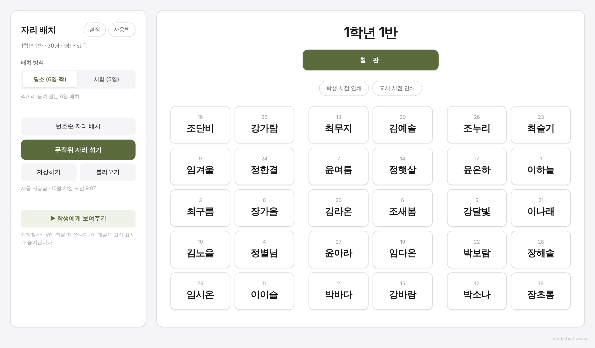
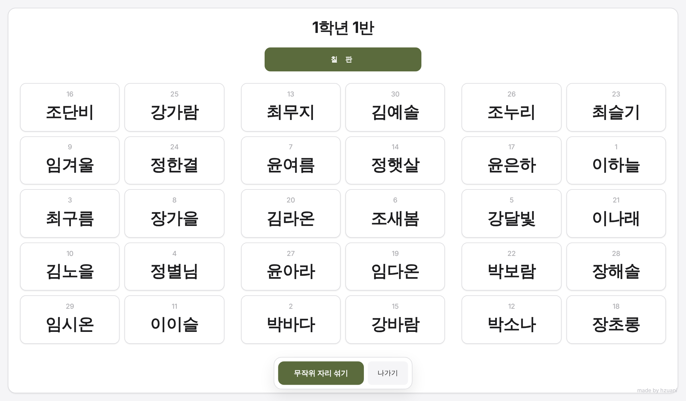

# 🪑 자리 배치 프로그램

> 나이스 명렬표 엑셀만 올리면, 학급 자리를 무작위로 섞고 전자칠판에 띄우고 인쇄까지 하는 웹 도구

**[▶ 바로 써보기](https://hzuani.github.io/random-seatchange/)** · 설치 없음 · 파일 하나(`index.html`)로 동작

※ 화면의 학생 이름은 모두 예시로 만든 가짜 이름입니다.

---

## 왜 만들었나

매달 자리를 바꿀 때마다 제비뽑기를 하거나 엑셀로 표를 고치는 게 번거로웠어요.
"짝은 떼어 놓고 싶은 학생", "앞자리에 앉혀야 하는 학생" 같은 조건까지 챙기려면 더 복잡해지고요.
그래서 **명단 → 섞기 → 보여주기 → 인쇄**를 한 화면에서 끝내는 도구를 만들었습니다.

## 주요 기능

| 기능 | 설명 |
|---|---|
| 📋 명단 불러오기 | 나이스 명렬표 엑셀(`.xlsx`)을 올리면 번호·이름이 자동으로 들어감. 명단 없이 학생 수만 적어도 사용 가능 |
| 🔀 무작위 섞기 | 섞는 모습을 애니메이션으로 보여줌. 섞을 횟수 설정 가능 |
| 🧩 배치 방식 | **평소** 6열 짝 배치 / **시험** 5열 번호순 배치 |
| 📌 자리 고정 | 고정한 학생은 섞어도 그 자리에 그대로. 마우스 오른쪽 클릭으로 **티 안 나게 몰래 고정**도 가능 |
| 🤝 학생 관계 | **떨어뜨리기**(짝·앞뒤·대각선 금지) / **짝으로 붙이기** |
| 🔁 자리 바꾸기 | 두 자리를 차례로 클릭하면 서로 교체 |
| ➖ 빼기 | 전출·결석 학생만 빼고 나머지 자리는 그대로 |
| 📺 학생에게 보여주기 | 전자칠판·TV용 전체 화면 모드 |
| 🖨️ 인쇄 | **학생 시점**(칠판이 위) / **교사 시점**(칠판이 아래) |
| 💾 저장·불러오기 | 배치를 `.json` 파일로 저장해 다음 달에 이어 쓰기. 브라우저 자동 저장도 지원 |

## 쓰는 법

1. **[바로 써보기](https://hzuani.github.io/random-seatchange/)** 를 열거나, `index.html`을 내려받아 브라우저로 엽니다.
2. 왼쪽 위 **설정**에서 학급명을 적고 명단 엑셀을 올립니다.
   - 나이스: `학급담임 → 기본학적관리 → 명렬표출력 → 조회 → 엑셀내려받기`
   - 연습용 명단: [`sample/예시_명렬표.xlsx`](sample/예시_명렬표.xlsx) (가짜 이름 30명)
3. **무작위 자리 섞기** → 필요하면 고정·교체로 조정
4. **학생에게 보여주기** 또는 **인쇄**

## 개인정보

- 학생 명단은 **내 컴퓨터 브라우저 안에서만** 처리되고, 어떤 서버로도 전송되지 않습니다.
- 다만 `저장하기`로 만든 `.json` 파일과 브라우저 자동 저장에는 학생 이름이 들어 있으니 관리에 유의해 주세요.
- 공용 컴퓨터에서는 쓰고 난 뒤 **설정 → 자동 저장 지우기**를 눌러 주세요.

## 만든 방법

- HTML · CSS · JavaScript 파일 하나 (프레임워크 없음)
- 엑셀 읽기: [SheetJS](https://sheetjs.com/) · 글꼴: [Pretendard](https://github.com/orioncactus/pretendard)
- Claude와 함께 바이브 코딩으로 제작

---

made by [hzuani](https://github.com/hzuani) · 학교 업무 도구를 만드는 국어 교사
